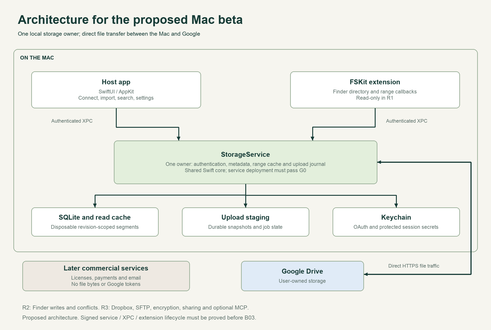

# System architecture

Draft v0.1 | 16 November 2026 | Proposed product design

The proposed design has one local data owner. UI and Finder integration call it through a narrow authenticated interface. File bytes go directly between the Mac and Google; a later license service remains outside that content path.

Proposed R1 architecture with later commercial services shown separately

## Ownership and lifecycle

StorageService serializes state changes and owns network operations. The host app handles account setup, imports and settings. The FSKit extension handles kernel-facing semantics and cancellation. If the service dies, the extension fails affected reads clearly, the host reports unavailable, and recovery reloads durable jobs before resuming. Do not report a successful save for uncommitted data.

The exact LaunchAgent/XPC and extension relationship is a feasibility decision, not a verified platform configuration. G0 requires a signed proof on the minimum OS. Never broaden filesystem or Keychain access merely to bypass a failed setup.

# Architecture decisions and product flow

| Decision | Status | Reason |
| --- | --- | --- |
| ADR01 Native Swift and FSKit | Proposed | Native lifecycle and byte-read control. Alternative File Provider can also support partial reads; FSKit is selected for direct virtual-volume semantics, not a claim that alternatives always download entire files. |
| ADR02 One Drive account first | Proposed | Use app-created files under drive.file. Exclude existing full-drive listing until explicit permission and verification work is planned. |
| ADR03 Single storage service | Spike required | Centralize token refresh, cache and writes. Prove signed XPC/service deployment in G0. If unavailable, document an extension-owned design and its lifecycle. |
| ADR04 Read-only Finder beta | Proposed | Menu-bar import provides a useful first release while avoiding premature claims about arbitrary application saves. |
| ADR05 No encryption in R1 | Proposed | Show the limitation clearly. R3 requires a format review, recovery tests and migration design before exposure to real user data. |
| ADR06 No commercial backend in R1 | Proposed | Keep prototype and private beta independent of licenses. Add TypeScript API, SQL, email and signed payment webhooks only at commercial release. |
| ADR07 New objects only | Proposed | Suffix duplicate names; never overwrite an existing remote object. Full revision-conflict handling is R2 work. |
| ADR08 Apple Silicon first | Proposed | Ship consistent architectures across every executable. Intel expansion needs its own hardware and compatibility run. |

## Data boundaries

Keychain: refresh credentials and protected session references. Application Support: durable staged files and job records. Read cache: disposable provider/account/revision-scoped segments. Product servers: no file bytes, filenames or cloud tokens. Future license records remain separate.

## Complete visual flow

The separate flowchart.png shows onboarding followed by two paths: a menu-bar import that becomes visible after verification, and a Finder read that uses cached or remote ranges. Offline retries and completion are different states; a pending upload is never shown as a verified remote file.

Editable diagram sources are included as SVG. The PNG exports are ready to share. The existing audit describes observed Feather Drive components; these architecture choices are for our implementation.

